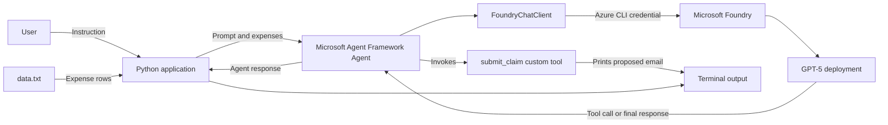

# Lab 07: Develop an AI Agent with Microsoft Agent Framework

## Project Overview

This lab implements an expense-claim assistant in Python with the Microsoft Agent Framework and Microsoft Foundry. The agent receives the expense rows from `python/data.txt` and the user's instruction, then prepares an itemized claim using a deployed GPT-5 model.

The `submit_claim` tool is a demonstration: it prints the proposed email recipient, subject, and body to the terminal. It does **not** send an email.

## Architecture



The Python application loads the Foundry project endpoint and model deployment name from environment variables. `FoundryChatClient` connects the Agent Framework agent to the deployed model, authenticating with `AzureCliCredential`, which uses the Azure CLI sign-in. The agent can invoke the decorated `submit_claim` function as its custom tool.

## Technologies

- **Python 3.13** — runtime version used by the lab instructions.
- **Microsoft Agent Framework** — agent and custom-tool integration (`agent-framework-core` 1.12.1).
- **Microsoft Foundry** — hosts the project and deployed GPT-5 model (`agent-framework-foundry` 1.10.3).
- **Azure Identity** — `AzureCliCredential` for Azure CLI authentication (`azure-identity` 1.25.3).
- **python-dotenv** — loads local environment variables from `.env`.
- **Pydantic 2** — `Field` descriptions used in the tool's annotated parameters.

Dependencies are listed in [`python/requirements.txt`](./python/requirements.txt).

## Agent Workflow

1. The application loads `python/data.txt` and displays its contents.
2. The user enters an instruction, such as “Submit an expense claim.”
3. The application creates a `FoundryChatClient` and an `ExpenseClaimAgent`, passing the instruction and expense data to `agent.run()`.
4. The model interprets the request and, when appropriate, calls `submit_claim` with a recipient, subject, and itemized claim body.
5. `submit_claim` prints those email fields to the terminal. No email is transmitted.
6. The application prints the agent's response.

## Setup and Execution

Prerequisites: Python 3.13, Azure CLI, an Azure subscription, and a Microsoft Foundry project with a GPT-5 deployment. The model must be available to your project and subscription.

From the repository root, create and activate a virtual environment, then install the lab dependencies in PowerShell:

```powershell
cd .\Labfiles\07-agent-framework\python
py -3.13 -m venv labenv
.\labenv\Scripts\Activate.ps1
python -m pip install -r requirements.txt
```

Create a `.env` file in the `python` directory with your own Foundry project endpoint and the name of your GPT-5 model deployment:

```dotenv
PROJECT_ENDPOINT=<your-foundry-project-endpoint>
MODEL_DEPLOYMENT_NAME=<your-gpt-5-deployment-name>
```

Keep `.env` local; do not commit credentials or environment-specific values. Sign in with the Azure CLI and run the application:

```powershell
az login
python .\agent-framework.py
```

When prompted, enter an instruction such as `Submit an expense claim`. To leave the virtual environment when finished, run `deactivate`.

## Example Execution

The lab's sample expense data is:

| Date | Description | Amount |
|---|---|---:|
| 07-Mar-2025 | Taxi | $24.00 |
| 07-Mar-2025 | Dinner | $65.50 |
| 07-Mar-2025 | Hotel | $125.90 |
| **Total** | | **$215.40** |

With the instruction `Submit an expense claim`, the agent is asked to prepare an itemized claim. The tool prints the proposed email to the terminal; the model-generated response is also displayed there. The exact wording can vary, and no real email is sent.

## Key Learning Outcomes

- Configure a Microsoft Agent Framework agent with instructions and a model client.
- Connect an agent to a Microsoft Foundry project and deployed model.
- Define a Python function as a custom agent tool using annotations and `@tool`.
- Execute the agent asynchronously and inspect its response and tool output.

## Software Engineering & DevOps Opportunities

Developing agents as code makes it possible to extend this lab with standard engineering practices. These are **potential future improvements**, not features implemented in this lab:

- Add `pytest` tests for expense formatting, totals, tool inputs, and agent behavior using suitable mocks.
- Add CI checks for formatting, linting, type checking, and automated tests.
- Integrate validated changes with a CI/CD workflow for controlled deployment.
- Improve reproducibility by pinning and documenting the full Python environment and configuration.
- Evolve the architecture to use a real email provider, stronger validation, observability, and explicit error handling.

This repository does not currently implement those tests, a CI/CD pipeline, or automated deployments for this lab.

## Attribution

This project follows the Microsoft Learn exercise [Develop an Azure AI chat agent with the Microsoft Agent Framework SDK](https://github.com/MicrosoftLearning/mslearn-ai-agents/blob/main/Instructions/Exercises/07-agent-framework.md). The exercise and starter material are provided by Microsoft; this README documents the implementation in this repository.
